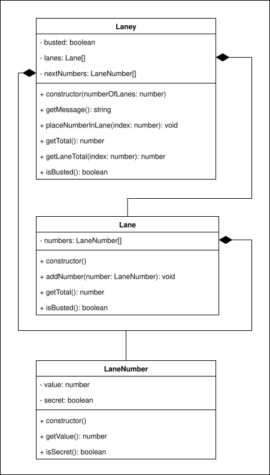
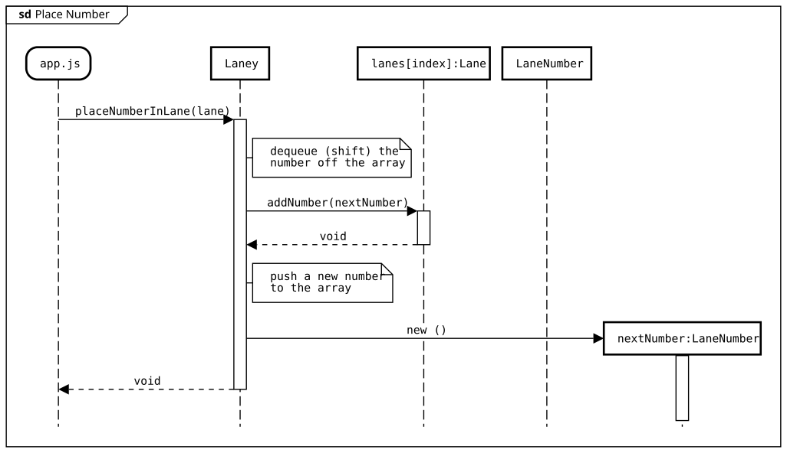
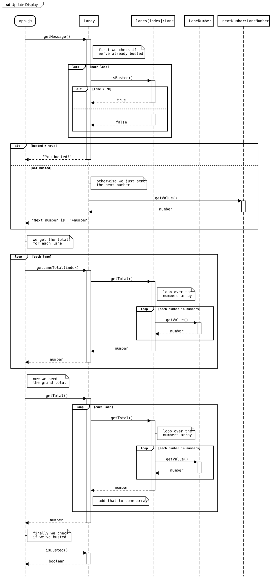

# Laney

Your goal is to get as close to 210 as possible without busting. 

You get a random number from 1 - 10 that you must place into a lane. You can choose in which lane to add the number. When you add a number to a lane, it gets added to the total. If the lane's total exceeds 70, the lane busts and the game is over.

A playable version can be found [here](https://hz-hbo-ict.github.io/ts-laney/)

## Class Diagram

Before looking at the class diagram below, attempt to analyse the the game and its components first.

### How it works

The player sees the next **three** numbers and can choose which lane to place the following number into. The number object is then passed to `Laney` class. The `Laney` class add it to the lane and the lane determines whether it has busted.

#### Bonus

There is a 10% chance once of the next numbers will be secret and will not be displayed before being added to the lane.

#### Placing a Number

#### Updating Display

